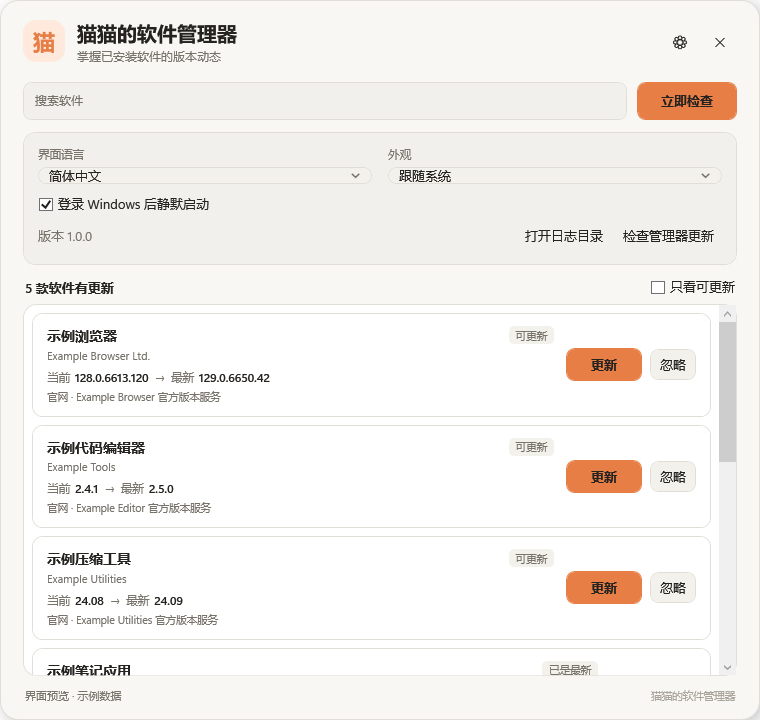

# 猫猫的软件管理器

一个面向 Windows 11 x64 的轻量软件版本管理器。程序登录后静默启动，每日首次满足“电源已接通、网络可用”时自动检查软件更新，并通过托盘浮窗展示当前版本、最新版本与更新入口。

项目主页：<https://github.com/McQueen228/cat-software-manager>



## 功能

- 登录 Windows 后静默启动，只显示系统托盘图标。
- 每个自然日最多自动检查一次；使用电池、离线或首次登录条件不满足时，会自动等待并在条件具备后补查。
- 扫描当前用户环境中的桌面软件和第三方 MSIX 应用，排除驱动、系统组件、运行库与 SDK。
- 优先读取软件官网的正式稳定版信息，并使用 Winget 辅助匹配和直接更新。
- 发现更新后显示汇总窗口。可确认更新、取消、跳过当前版本，或永久忽略该软件的更新提示。
- 更新前检查软件是否正在运行；不会擅自关闭程序，也不会自动重启电脑。
- 左键点击托盘图标打开紧凑浮窗，支持搜索、仅看可更新、语言切换和深浅色主题。
- 每日自动检查管理器自身的新版本，并可从 GitHub Releases 下载安装包完成更新。
- 中文/英文界面、数据保存在本机、不发送遥测。

## 版本规则

Windows 没有统一的“任意软件官网最新版”接口，因此所有版本识别都遵循以下原则：

1. 有官方稳定版接口或发布页时，以官网结果为准。
2. Winget 作为第二版本通道。Winget 能更新到官网版本时，点击更新会直接安装；若 Winget 仓库尚未同步到官网版本，则按钮显示“打开官网”，避免安装一个仍然落后的版本。
3. 找不到可靠来源时显示“暂无可靠版本源”，不会根据相似名称或版本号猜测最新版。
4. GitHub 版本源只读取最新正式 Release，不读取草稿或预发布版本。
5. Python 使用官方 release API，并校验 `is_latest=true`、`pre_release=false`、主版本为 3。当前官方稳定版为 3.15.1，不会把开发版目录误认为稳定版。

当前内置官网源包括 Chrome、Edge、VS Code、Firefox、Git for Windows、7-Zip、Node.js、Python、OBS Studio、PowerToys、Arduino IDE、Bambu Studio、Obsidian、Notepad++ 和 Blender。

可在 `%LOCALAPPDATA%\CatSoftwareManager\version-sources.json` 放置同格式的扩展规则。规则文件中相同 `id` 会覆盖内置规则。

## 更新与权限

直接更新通过 `winget upgrade` 执行。部分安装程序需要管理员权限，Windows 会显示 UAC 提示；出于系统安全限制，应用不会也不能自动点击 UAC 确认。没有可用直接更新通道时，会打开软件官网下载页。

## 本地数据

- 设置、忽略/跳过记录：`%LOCALAPPDATA%\CatSoftwareManager\settings.json`
- 日志：`%LOCALAPPDATA%\CatSoftwareManager\logs\`
- 扩展版本源：`%LOCALAPPDATA%\CatSoftwareManager\version-sources.json`

卸载程序会移除安装文件和开机启动项，但保留上述用户数据，方便以后恢复。

## 构建

环境要求：

- Windows 11 x64
- .NET SDK 8 或更高版本
- Inno Setup 6（仅生成安装包时）

```powershell
winget install JRSoftware.InnoSetup
.\scripts\build.ps1
```

构建产物：

- `artifacts/CatSoftwareManager-Setup-v1.0.0-x64.exe`
- `artifacts/CatSoftwareManager-Portable-v1.0.0-x64.zip`

## 测试

```powershell
dotnet run --project .\tests\CatSoftwareManager.SmokeTests
```

测试包括版本比较、Winget 中文表格解析、Python 官方稳定版校验，以及对本机软件的实际扫描。

如需在无桌面环境中生成界面快照，可运行：

```powershell
dotnet run --project .\tests\CatSoftwareManager.SmokeTests -- --render-ui .\ui-preview.png
```

## 已知限制

- 仅支持 Windows 11 x64 和当前 Windows 用户。
- 便携版软件、商店沙盒内部版本以及没有可靠官网/发布接口的软件，可能只能显示安装版本。
- 官网页面结构变化会导致对应规则失效。规则失败时会保留“无法检测”状态，不会伪造结果。
- UAC 必须由用户确认。
